# Gas_App Financiero · Manual Operativo Integral

**Guía de Funcionalidades, Menús y Flujo de Trabajo Operativo**  
*Control de Cartera CxC y Sistema de Débito Prepago para Estaciones de Servicio*

---

## Índice General
1. [Introducción y Arquitectura General](#1-introducción-y-arquitectura-general)
2. [Roles de Usuario y Permisos](#2-roles-de-usuario-y-permisos)
3. [Flujo y Orden de Operación Recomendado](#3-flujo-y-orden-de-operación-recomendado)
   - [Fase 1: Configuración Inicial](#fase-1-configuración-inicial-puesta-en-marcha)
   - [Fase 2: Operación Diaria (Día a Día)](#fase-2-operación-diaria-día-a-día)
   - [Fase 3: Cierres, Actualizaciones y Respaldo](#fase-3-cierres-actualizaciones-y-respaldo)
4. [Encabezado y Filtros Globales (Contexto)](#4-encabezado-y-filtros-globales-contexto)
5. [Detalle de Menús y Pestañas](#5-detalle-de-menús-y-pestañas)
   - [1. Cartera Activa (CxC)](#1-cartera-activa-cxc)
   - [2. Aplicación de Pagos (CxC)](#2-aplicación-de-pagos-cxc)
   - [3. Por Facturar](#3-por-facturar)
   - [4. Control de Débito (Prepago)](#4-control-de-débito-prepago)
   - [5. Cobranza](#5-cobranza)
   - [6. Alertas](#6-alertas)
   - [7. Clientes y Ficha de Cliente](#7-clientes-y-ficha-de-cliente)
   - [8. Catálogos (Bancos y Métodos de Pago)](#8-catálogos-bancos-y-métodos-de-pago)
   - [9. Usuarios y Roles / Bitácora](#9-usuarios-y-roles--bitácora)
   - [10. Carga de Datos](#10-carga-de-datos)
6. [Reglas de Negocio, Fórmulas y Cálculos](#6-reglas-de-negocio-fórmulas-y-cálculos)

---

## 1. Introducción y Arquitectura General

**Gas_App Financiero** es una solución integral para el control de cuentas por cobrar (CxC), facturación de despachos a crédito y administración de saldos a favor (débito prepago) en estaciones de servicio gasolineras.

### Principios Fundamentales:
- **Base de datos:** requiere `@libsql/client`; usa SQLite local (`data/cartera.db`) por defecto y Turso si están configuradas `TURSO_DATABASE_URL` y `TURSO_AUTH_TOKEN`.
- **Separación estricta de esquemas financieros:**
  - **Cartera CxC:** Crédito otorgado con vencimiento a plazo, facturas y saldos por cobrar.
  - **Débito Prepago:** Anticipos y depósitos recibidos previamente de los que se van descontando consumos de combustible (saldos a favor del cliente).

---

## 2. Roles de Usuario y Permisos

El sistema implementa control de acceso basado en roles (RBAC) con alcance por estación:

| Rol | Alcance de Estaciones | Permisos Operativos |
|---|---|---|
| **Administrador General** | Acceso a todas o estaciones específicas | Acceso total: Usuarios, bitácora de auditoría, carga y reemplazo de Excel, catálogos maestros (bancos, métodos), clientes, crédito, facturas, cobros y débito. |
| **Gestor de Estación** | Limitado a una o varias estaciones asignadas | Operación diaria en sus estaciones: Registrar facturas, aplicar cobros, movimientos de débito prepago, dar de alta clientes y editar condiciones de crédito, y registrar gestiones de cobranza. |
| **Supervisor** | Limitado a una o varias estaciones asignadas | Puede anular prepagos, modificar importes de despachos pendientes y anular pagos; no puede registrar pagos o movimientos ni administrar usuarios. |
| **Consulta** | Global o por estación | Solo lectura: Visualización de indicadores, reportes, fichas y exportación de tablas a formato CSV. |

Al crear o editar usuarios, marca **Acceso a todas las estaciones** para incluir las estaciones futuras, o desmárcala para seleccionar estaciones específicas desde el desplegable dinámico. Usa **Seleccionar todas** para elegir rápidamente todas las estaciones actuales. Debe seleccionarse al menos una estación en el modo específico. Las asignaciones se guardan en `usuario_estaciones`, con referencias a usuarios y estaciones.

---

## 3. Flujo y Orden de Operación Recomendado

Para garantizar la integridad financiera de las cuentas y evitar discrepancias de saldos, se debe seguir el siguiente orden operativo:

```mermaid
flowchart TD
    A[Fase 1: Configuración Inicial] --> B[Fase 2: Operación Diaria]
    B --> C[Fase 3: Cierre y Actualización]
    
    subgraph S1 [Fase 1: Configuración]
        A1[1. Acceso y cambio de contraseña] --> A2[2. Configurar Bancos y Métodos de Pago]
        A2 --> A3[3. Alta / Verificación de Clientes y Crédito]
        A3 --> A4[4. Creación de Usuarios y Asignación de Estaciones]
    end

    subgraph S2 [Fase 2: Día a Día]
        B1[1. Revisión de KPIs y Alertas] --> B2[2. Registrar Recargas / Consumos Débito]
        B2 --> B3[3. Facturar Despachos Pendientes]
        B3 --> B4[4. Registrar Facturas Manuales]
        B4 --> B5[5. Aplicar Pagos y Cobros CxC]
        B5 --> B6[6. Seguimiento a Cobranza y Promesas]
    end

    subgraph S3 [Fase 3: Cierres y Mantenimiento]
        C1[1. Ajuste de Fecha de Corte / Auditoría] --> C2[2. Exportación de Reportes CSV]
        C2 --> C3[3. Carga Parcial/Completa de Excel]
        C3 --> C4[4. Respaldos Periódicos de la BD]
    end
```

---

### Fase 1: Configuración Inicial (Puesta en Marcha)

1. **Primer inicio de sesión y cambio de credenciales:**
   - Iniciar sesión con usuario `admin` y la contraseña temporal generada en consola.
   - El sistema obligará a definir una contraseña segura (mínimo 8 caracteres combinando letras y números).
2. **Definición de Catálogos Financieros Básicos (Pestaña *Catálogos*):**
   - **Bancos:** Verificar o dar de alta las cuentas bancarias donde se reciben depósitos (ej. BBVA, Santander, Banco Azteca, etc.).
   - **Métodos de Pago:** Configurar los métodos aceptados (Transferencia SPEI, Efectivo, Cheque, Tarjeta, Compensación) y marcar cuáles requieren banco obligatorio en CxC.
3. **Clientes y Asignación de Crédito (Pestaña *Clientes*):**
   - Asegurarse de que cada cliente esté registrado con su estación correspondiente, RFC, correo, teléfono, **límite de crédito ($)** y **días de crédito**.
   - *Nota:* Sin días de crédito, no se pueden proyectar vencimientos automáticos.
4. **Alta de Usuarios Operativos (Pestaña *Usuarios y Roles*):**
   - Asignar a cada usuario el rol que corresponda y limitarlo a las estaciones que debe operar; usa *Supervisor* para las tres acciones de anulación/edición específicas.

---

### Fase 2: Operación Diaria (Día a Día)

1. **Revisión de Cabecera y Alertas:**
   - Entrar al sistema y revisar las 4 tarjetas superiores de KPI (Facturas abiertas, Saldo abierto, Saldo vencido, Saldo a favor).
   - Entrar a la pestaña **Alertas** para identificar:
     - Promesas de pago que vencen hoy o están vencidas.
     - Clientes que superaron su límite de crédito disponible.
     - Facturas con más de 60 días de antigüedad.
2. **Atención de Clientes Prepago (Pestaña *Control de Débito*):**
   - Si un cliente deposita dinero: Registrar un **Abono (+)** seleccionando método de pago, banco receptor, folio del comprobante y monto.
   - Si un cliente retira combustible a cuenta de su saldo: Registrar un **Consumo (−)** con el folio del ticket/nota.
3. **Revisión y Emisión de Despachos (Pestaña *Por Facturar*):**
   - Revisar los consumos pendientes de facturar provenientes del sistema o capturados en la app.
   - Al emitir la factura fiscal del cliente: Pulsar **"Seleccionar despachos"**, marcar los despachos que cubre la factura, ingresar el folio y fecha de la factura. El monto pasa de inmediato a **Cartera Activa**.
4. **Registro de Nuevas Facturas Manuales (Pestaña *Cartera Activa*):**
   - Si se emitieron facturas de crédito no asociadas a despachos directos: En el formulario superior capturar cliente, número de factura, importe y fecha. El sistema calcula automáticamente la fecha de vencimiento.
5. **Aplicación de Cobranza (Pestaña *Aplicación de Pagos (CxC)* o *Cartera Activa*):**
   - **Pago puntual a una factura:** En Cartera Activa, pulsar el botón "Pago" en el renglón correspondiente.
   - **Cobro de cliente con múltiples facturas:** En Aplicación de Pagos, buscar el cliente, capturar el monto cobrado, fecha, método y banco:
     - Usar **Distribuir Automático (FIFO)** para liquidar las facturas más viejas primero.
     - Si el depósito no se ha identificado o no se desea liquidar aún: Usar **Guardar monto total sin aplicar**.
6. **Seguimiento a Deudores (Pestaña *Cobranza* y *Ficha del Cliente*):**
   - Llamar o contactar a los clientes en mora.
   - Registrar la gestión (Llamada, WhatsApp, Visita) con su resultado (Contactado, Promesa de pago). Si hubo promesa, definir fecha y monto comprometido.

---

### Fase 3: Cierres, Actualizaciones y Respaldo

1. **Análisis a Fecha de Corte:**
   - Usar el selector de fecha del encabezado para evaluar el estado de la cartera a fin de mes o a una fecha histórica.
2. **Exportación de Datos:**
   - Descargar los reportes en CSV de Cartera Activa y Catálogo de Clientes para auditoría externa o conciliación contable.
3. **Actualización de Información vía Excel (Pestaña *Carga de Datos*):**
   - Si se procesa un nuevo archivo maestro `Gas_App.xlsx`:
     - **Carga Parcial:** Si solo se actualizan despachos CxC o Débito, preservando usuarios, clientes y movimientos manuales.
     - **Carga Completa:** Solo si se desea reiniciar la base con el archivo maestro desde cero.
4. **Respaldos de Seguridad:**
   - El sistema genera respaldos automáticos antes de cada carga de datos en la carpeta `respaldos/`.
   - Se recomienda ejecutar periódicamente `node server/respaldo.js` mediante el Programador de Tareas de Windows.

---

## 4. Encabezado y Filtros Globales (Contexto)

La barra superior permanece visible en todas las pantallas y condiciona todos los cálculos:

- **Selector de Estación:** Permite alternar entre una estación particular o "Todas las estaciones" (los gestores solo verán sus estaciones autorizadas).
- **Selector de Fecha de Corte:** Determina la fecha respecto a la cual se evalúan los vencimientos y días de mora.
  - Botón **Hoy:** Ajusta el corte a la fecha actual del sistema.
  - Botón **Fecha de datos:** Regresa a la fecha de corte original del archivo de datos cargado.
- **Tarjetas KPI Globales:**
  - *Facturas abiertas (CxC):* Conteo total de facturas pendientes y número de clientes deudores.
  - *Saldo abierto (CxC):* Monto total facturado pendiente de cobro + monto por facturar acumulado.
  - *Saldo vencido (CxC):* Monto con fecha de vencimiento rebasada, porcentaje sobre el total y saldo a más de 60 días.
  - *Saldo a favor (Débito):* Total de dinero disponible en prepago de clientes a favor.

---

## 5. Detalle de Menús y Pestañas

---

### 1. Cartera Activa (CxC)
Es la pantalla central de cuentas por cobrar. Muestra todas las facturas de crédito emitidas y sus estados de pago.

#### Componentes y Funciones:
- **Gráfica de Antigüedad de Saldos (Aging):** Muestra barras interactivas por rango (No vencido, 1-15, 16-30, 31-60, 61-90, 91-120, más de 120 días). Al hacer clic en una barra, la tabla se filtra inmediatamente por ese rango.
- **Gráfica de Facturado vs Cobrado:** Comparativa mes a mes de los últimos 12 meses.
- **Formulario "Registrar factura o saldo nuevo" (Solo Gestor / Admin):**
  - Permite dar de alta una factura capturada en la app para cualquier cliente existente.
  - Al seleccionar cliente y fecha de emisión, muestra en tiempo real la fecha de vencimiento proyectada calculada con los días de crédito del cliente.
- **Filtros Avanzados:**
  - Búsqueda por texto (nombre de cliente o número de folio).
  - Estado: *Abiertas (con saldo)*, *Vencidas*, *Por vencer*, *Pagadas* o *Todas*.
  - Rango de antigüedad, fecha por (Facturación, Vencimiento o Despacho), año, mes y rango de fechas (Desde / Hasta).
  - Botón **⬇ CSV**: Exporta la lista filtrada con fórmulas seguras contra inyección.
- **Detalle de Factura (Modal al hacer clic en el renglón):**
  - Desglose completo: Importe original, abonos en Excel, pagos capturados en la app y saldo pendiente actual.
  - Lista de pagos registrados en la aplicación con opción de **Anular** (restableciendo el saldo).
  - Desglose de despachos de combustible individuales que integran esa factura.
  - Botón para editar la factura (si fue capturada manualmente y no supera abonos previos).

---

### 2. Aplicación de Pagos (CxC)
Diseñada para aplicar cobranza recibida (depósitos bancarios, cheques, efectivo) contra una o varias facturas de un cliente.

#### Modos de Aplicación:
1. **Selección del Cliente:** El buscador inteligente permite teclear el nombre del cliente y cargar automáticamente todas sus facturas pendientes ordenadas por vencimiento.
2. **Datos del Cobro:**
   - Fecha de pago, folio/referencia de rastreo (ej. número de transferencia SPEI).
   - Método de pago y Banco receptor (el selector de banco se activa y hace obligatorio según el método de pago configurado).
   - Monto total cobrado.
3. **Mecanismos de Distribución:**
   - **Botón "Distribuir Automático (FIFO)":** Asigna el dinero disponible comenzando por la factura más antigua o con mayor vencimiento hasta agotar el monto.
   - **Asignación Manual:** El usuario puede teclear en cada factura la cantidad exacta que desea abonar.
   - **Botón "Guardar monto total sin aplicar":** Si el pago ingresó al banco pero no se sabe aún a qué facturas corresponde, se guarda como saldo no aplicado sin alterar el saldo de facturas específicas.
   - **Manejo de Sobrantes:** Si el pago es de $10,000 y las facturas sumaban $8,000, los $2,000 restantes se guardan automáticamente como pago "Sin aplicar" a favor de la cuenta del cliente.

---

### 3. Por Facturar
Concentra todos aquellos despachos de combustible otorgados a crédito que han salido de la estación pero aún no cuentan con una factura fiscal asociada.

#### Funciones Principales:
- **Resumen:** Indicadores de monto total por facturar y cantidad de despachos.
- **Formulario "Registrar monto pendiente por facturar":** Permite ingresar consumos a crédito pendientes de timbrar con fecha y descripción.
- **Tabla por Cliente:** Agrupa los despachos pendientes mostrando fecha del más antiguo, fecha del más reciente y días de antigüedad acumulados.
- **Botón "Seleccionar despachos" (Emisión de Factura):**
  - Abre un modal con la lista de despachos pendientes del cliente.
  - Permite marcar/desmarcar con casillas de verificación cuáles despachos se incluirán en la factura.
  - Solicita el número de factura y fecha de emisión.
  - Al procesar, los despachos seleccionados se marcan como facturados y se genera la nueva factura en **Cartera Activa** con su saldo correspondiente.

---

### 4. Control de Débito (Prepago)
Módulo totalmente independiente de CxC para clientes que pagan anticipadamente por su combustible.

#### Funciones y Operaciones:
- **Panel Izquierdo - Registrar Movimiento:**
  - Selección de Cliente.
  - **Abono (+):** Entrada de dinero prepago. Obliga a seleccionar método de pago y banco receptor, además de folio y monto.
  - **Consumo (−):** Descuento de combustible consumido. Solo requiere monto, fecha y folio de ticket.
- **Control de Sobregiros:** Si un consumo supera el saldo a favor, el sistema permite registrarlo pero emite una advertencia visual ("Consumido en exceso") y el saldo se torna negativo.
- **Panel Derecho - Clientes con Saldo a Favor e Historial:**
  - Tarjeta de clientes con saldo disponible a favor.
  - Tabla de movimientos paginada con filtro por operación (Abonos o Consumos) y fechas.
  - Botón **Anular** en movimientos registrados en la app para corregir errores de captura.

---

### 5. Cobranza
Módulo de control de gestión y seguimiento a clientes morosos.

#### Subpestañas:
1. **Gestiones y Promesas:**
   - Muestra las gestiones realizadas (Llamada, WhatsApp, Correo, Visita, Otro) y sus resultados.
   - Si se obtuvo una promesa, muestra la fecha límite y el importe prometido.
   - Selector interactivo de estado de la gestión: *Abierta*, *Cumplida*, *Incumplida* o *Cerrada*.
2. **Pagos Capturados:**
   - Bitácora completa de todos los cobros registrados en la plataforma.
   - Muestra qué facturas cubrió cada pago o si se encuentra como *Sin aplicar* o *Conciliado*.
   - Botón para anular pagos activos si se cometió una equivocación.

---

### 6. Alertas
Pantalla de monitoreo preventivo de riesgos calculada a la fecha de corte. Cuenta con un contador dinámico (*badge*) en la barra de navegación.

#### Secciones de Alerta:
1. **Promesas de pago por cumplir:** Gestiones con fecha de promesa vencida o que vencen el día de hoy y continúan en estatus abierto.
2. **Clientes sobre su límite de crédito:** Clientes cuyo saldo total (facturado + por facturar) supera el límite de crédito financiero autorizado. Muestra el importe excedido en color rojo.
3. **Facturas con más de 60 días vencidas:** Facturas con morosidad crítica ordenadas por monto para priorizar cobranza jurídica o inmediata.
4. **Próximas a vencer (7 días):** Facturas cuyo vencimiento ocurrirá en los próximos 7 días; ideal para recordatorios preventivos y llamadas de cortesía.
5. **Con saldo y sin límite de crédito:** Clientes que mantienen deuda pero tienen límite configurado en $0.00 (requieren regularización de expediente).
6. **Despachos sin facturar con más de 15 días:** Combustible despachado hace más de dos semanas que sigue sin facturarse.
7. **Facturas abiertas sin fecha de vencimiento:** Calidad de datos; facturas sin días de crédito o sin fecha que no pueden ser clasificadas por antigüedad.

---

### 7. Clientes y Ficha de Cliente
La pestaña **Clientes** concentra el catálogo y la administración de la información financiera y de contacto de cada cliente.

#### Catálogo de Clientes:
- Formulario de alta rápida de clientes con: Nombre, estación asignada, número de cliente, RFC, límite de crédito, días de crédito, correo y teléfono.
- Tabla maestra con búsqueda por RFC, nombre o folio, y filtros de riesgo: *Con saldo*, *Vencido*, *Excedido*, *Sin límite*, *Con saldo a favor*.
- Exportación completa a CSV.

#### Ficha Individual del Cliente (Vista 360°):
Al hacer clic en cualquier cliente en cualquier parte del sistema, se abre su ficha detallada:
- **Tarjetas superiores:** Límite de crédito, días de crédito, saldo total, crédito disponible (% de uso), saldo vencido y saldo a favor de débito prepago.
- **Gráfica particular de antigüedad de saldos** de ese cliente.
- **6 Pestañas de detalle interno:**
  1. *Facturas abiertas:* Facturas vigentes con botón de pago directo.
  2. *Por facturar:* Despachos pendientes de facturación de este cliente.
  3. *Débito:* Resumen de recargas vs consumos y tabla de los últimos 200 movimientos prepago.
  4. *Gestiones:* Formulario para registrar una nueva llamada, visita o promesa de pago, y lista de gestiones históricas.
  5. *Pagos:* Historial de todos los pagos capturados para este cliente.
  6. *Historial:* Facturación vs cobranza mes con mes para análisis de comportamiento de pago.
- **Estado de cuenta CSV:** desde la ficha se descarga el detalle de despachos, facturas, abonos, pagos, movimientos de prepago y gestiones. El rango Desde/Hasta es opcional; al usar Desde, el archivo incluye el saldo inicial del período.

---

### 8. Catálogos (Bancos y Métodos de Pago)
Módulo de administración de parámetros de pago. La administración de clientes se realiza exclusivamente en la pestaña **Clientes**.

#### Catálogo de Bancos (Solo Admin):
- Alta, edición de nombre y eliminación de bancos para registro de depósitos y transferencias.

#### Catálogo de Métodos de Pago (Solo Admin):
- Alta y edición de métodos.
- Casilla: *"Requiere banco en pagos CxC"*, que fuerza a capturar el banco cuando se use este método en cobranza.

---

### 9. Usuarios y Roles / Bitácora
Acceso exclusivo para el Administrador General.

#### Funcionalidades:
- **Alta de Usuarios:** Define nombre, nombre de usuario para inicio de sesión, correo electrónico, rol y una o múltiples estaciones asignadas.
- **Contraseñas Temporales Seguras:** Al dar de alta o restablecer un usuario, se muestra una contraseña temporal en pantalla que el usuario debe cambiar obligatoriamente en su primer ingreso.
- **Edición y Bloqueo:** Permite cambiar roles, estaciones o inactivar usuarios que salgan de la empresa sin borrar sus registros históricos.
- **Bitácora de Auditoría:** Enlace a la vista con los últimos 300 eventos del sistema (inicio de sesión, pagos aplicados, anulaciones, modificaciones de crédito, altas de clientes e IP de origen).

---

### 10. Carga de Datos
Módulo para sincronizar o migrar información a partir de un libro maestro de Excel (`Gas_App.xlsx`).

#### Opciones de Carga:
1. **Carga Completa:**
   - Reemplaza todo el modelo de datos.
   - Borra datos operativos de la app (pagos manuales, usuarios, movimientos de app) y vuelve a crear el usuario administrador inicial.
   - *Se debe usar únicamente al reiniciar el sistema o en migraciones anuales completas.*
2. **Carga Parcial (Recomendada para actualización periódica):**
   - Permite seleccionar con casillas de verificación cuáles hojas reemplazar:
     - *Clientes y crédito* (`Dim_Clientes` + `Credito`).
     - *CxC / Cartera* (`CxC`).
     - *Débito prepago* (`Debito`).
   - Conserva los usuarios, clientes creados en la app, gestiones de cobranza y pagos manuales (los cuales se marcan automáticamente como *conciliados*).
3. **Respaldo Automático:** Toda carga genera un respaldo previo e íntegro de la base de datos en la carpeta `respaldos/` antes de aplicar cambios, revirtiéndose automáticamente si se detecta cualquier error de formato en el archivo.

---

## 6. Reglas de Negocio, Fórmulas y Cálculos

1. **Saldo de Factura:**
   $$\text{Saldo} = \text{Importe Factura} - \text{Abono en Excel} - \sum \text{Pagos Registrados en App}$$
   *(Solo aplica a facturas en estatus `POR PAGAR` o `ABONADO`).*

2. **Cálculo de Vencimiento de Factura:**
   $$\text{Fecha Vencimiento} = \text{Fecha Factura} + \text{Días de Crédito del Cliente}$$
   *Si se modifican los días de crédito de un cliente en Catálogos, todas sus facturas activas recalculan su fecha de vencimiento y sus días vencidos automáticamente.*

3. **Días Vencido (Mora):**
   $$\text{Días Vencido} = \text{Fecha de Corte} - \text{Fecha de Vencimiento}$$
   - Si $\text{Días Vencido} \le 0$: Se clasifica como **No Vencido (Al corriente)**.
   - Si $\text{Días Vencido} > 0$: Se clasifica en los rangos: **1-15**, **16-30**, **31-60**, **61-90**, **91-120** o **más de 120 días**.

4. **Cartera Total del Cliente:**
   $$\text{Cartera Total} = \text{Saldo Facturado Pendiente} + \text{Monto Despachos Por Facturar}$$

5. **Nivel de Riesgo Crediticio:**
   - **EXCEDIDO:** Cuando $\text{Cartera Total} > \text{Límite de Crédito Autorizado}$.
   - **SIN LÍMITE:** Cuando $\text{Cartera Total} > 0$ y el $\text{Límite de Crédito} = 0$.
   - **OK:** Cuando la cartera total se encuentra dentro del margen de crédito autorizado.

6. **Saldo de Débito (Prepago):**
   $$\text{Saldo a Favor} = \sum \text{Abonos (Recargas)} - \sum \text{Consumos}$$
   *El saldo de débito prepago nunca se mezcla contablemente con la cartera de crédito (CxC).*

7. **Seguridad y Bloqueo de Cuentas:**
   - Las contraseñas están encriptadas con algoritmo `scrypt`.
   - Después de **5 intentos fallidos consecutivos**, la cuenta se bloquea automáticamente durante **15 minutos** para evitar ataques de fuerza bruta.
